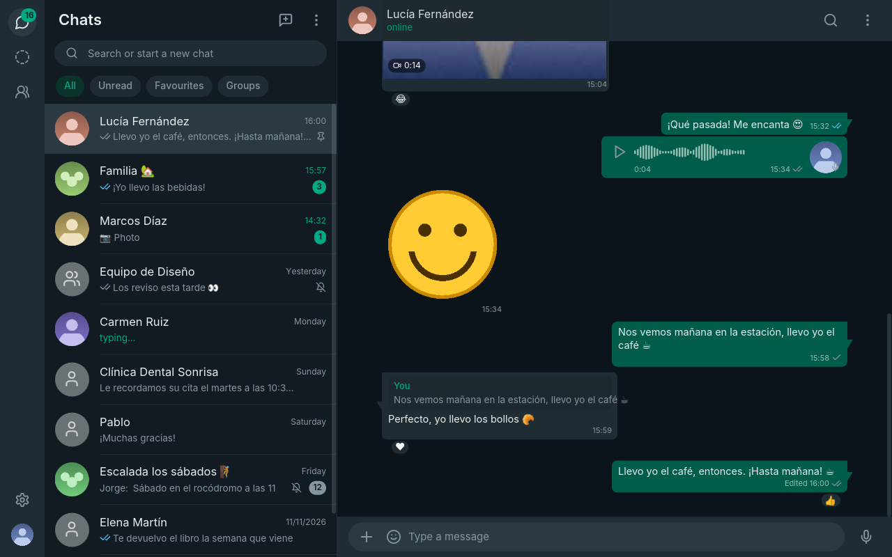
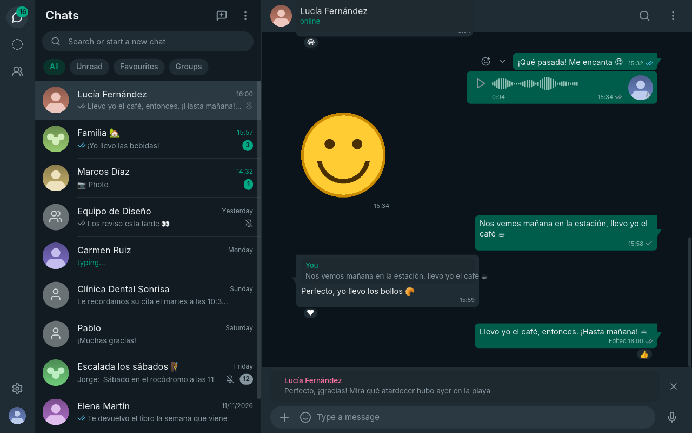
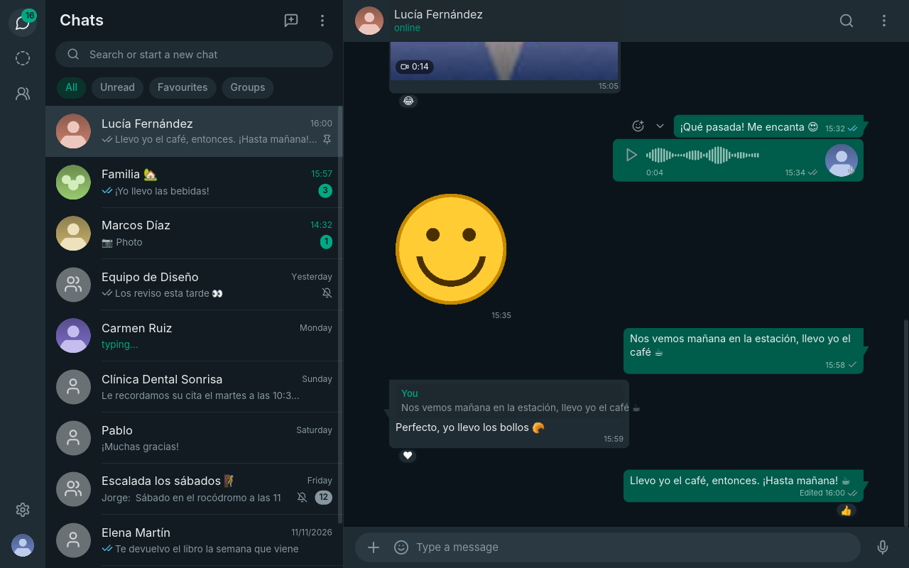
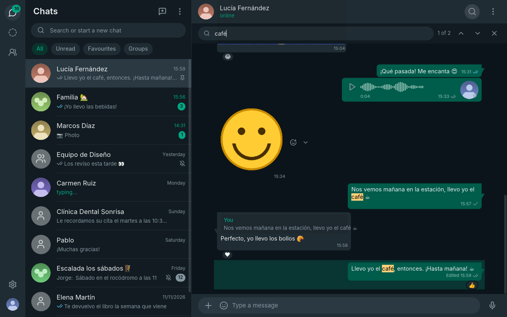

# Ferrochat

A lightweight, native WhatsApp desktop client written in Rust. It links to
your phone as a companion device (like WhatsApp Web / Desktop), using the
pure-Rust [`whatsapp-rust`](https://github.com/jlucaso1/whatsapp-rust)
implementation of the multi-device protocol, and draws its UI with
[`iced`](https://iced.rs) in a look that closely follows WhatsApp Desktop's
dark theme.

> [!WARNING]
> **Unofficial client.** Ferrochat is not affiliated with, endorsed by or
> supported by WhatsApp or Meta. **Third-party clients break WhatsApp's
> terms of service and can get your account temporarily or permanently
> banned.** Use it at your own risk, ideally with an account you can afford
> to lose. No WhatsApp logos, icons or fonts are shipped; the look is
> recreated with Inter (OFL) and Lucide icons (ISC).



| Reply and menu | Reactions | Search in chat |
|---|---|---|
|  |  |  |

## Features

* QR-code pairing as a linked device (codes refresh automatically, reload
  when they run out), logout / unlink.
* Chat list with search, filter chips (All / Unread / Favourites / Groups),
  unread badges, pinned and muted markers, last-message preview with ticks.
* History from WhatsApp's history sync, cached in SQLite; older pages load
  when scrolling up.
* Send and receive text, photos, documents and voice notes (record with the
  mic button, play back with a waveform).
* Read receipts, both ways: grey / blue ticks on your messages, read and
  played receipts sent when you open a chat or play a voice note.
* Profile pictures for chats and contacts (bounded in-memory LRU plus a disk
  cache; the grey default stays as the fallback).
* Replies (quoted message, click to jump, reply bar), reactions (badge, who
  reacted, hover picker, send and remove), edit (15 min) and delete for me /
  for everyone, "Edited" marker.
* Typing and recording indicators, online / last seen, and our own throttled
  "typing…" presence.
* Search in the chat list (chats and cached messages) and inside a chat, with
  jump to the result.
* Video (thumbnail and duration, opens in the system player) and stickers
  (WebP, static; animated ones show their first frame).
* Group ticks turn blue only once every participant has read the message.
* Desktop notifications (sender + preview, or sender only).

See [docs/protocol.md](docs/protocol.md) for what works, what is stored on
disk and the known gaps.

## Build

Rust stable (edition 2024, ≥ 1.94) and, on Debian/Ubuntu:

```sh
sudo apt-get install -y pkg-config cmake libdbus-1-dev libasound2-dev \
  libxkbcommon-dev libwayland-dev libssl-dev libfontconfig1-dev
cargo build --release
```

`libssl-dev` is needed for SQLCipher (the encrypted session store);
`cmake` builds the bundled libopus, which is linked statically
(`.cargo/config.toml` sets `LIBOPUS_NO_PKG=1`), so the binary needs no
libopus package at runtime. Runtime packages: OpenSSL's `libcrypto`, ALSA /
PipeWire, D-Bus, a Secret Service (KWallet or GNOME Keyring) and
`xdg-open`. Linux (KDE Plasma / Wayland) is the primary
target; Windows and macOS should build but are not tested.

## Run

```sh
./target/release/ferrochat            # real account: scan the QR code with your phone
./target/release/ferrochat --mock     # demo data, no network, nothing written to disk
./target/release/ferrochat --screenshot chat out.png   # render a mock screen and exit
```

A Secret Service (KWallet or GNOME Keyring) is required: Ferrochat stores
the key of its encrypted session database there and refuses to fall back to
a plain file.

Environment: `RUST_LOG` (log filter), `FERRO_THEME=light`,
`FERRO_TRACE_STARTUP=1` (prints `first_frame_ms`), `FERROCHAT_NOTIFY=sender`
(notifications without message preview), `FERROCHAT_DATA_DIR`.

## Development

```sh
cargo fmt --check
cargo clippy --all-targets -- -D warnings
cargo test
```

Architecture: [docs/architecture.md](docs/architecture.md). Lessons learned:
[LESSONS.md](LESSONS.md).

## Licence

MIT. Inter is under the SIL Open Font License 1.1, Lucide icons under ISC
(see `assets/`).
